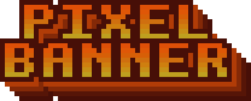
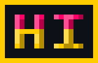
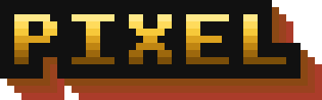
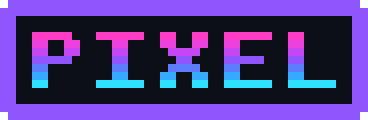

<div align="center">


[Читать на русском](README.ru.md)

</div>

pixban turns a line of text into pixel art. Pick a built-in font and a palette, add a shadow, an outline, a bevel or a plate, and save the result as SVG, PNG, GIF or APNG. It is made for the things people put at the top of a project: a logo for a README, a banner for a release page, a title for a docs site.

The same text also works in a terminal. pixban can print it in color, animate it in place, or draw it with plain `#` characters for a shell banner.

## Install

From a clone of this repository:

```sh
cargo install --locked --path crates/pixban-cli
```

This puts a `pixban` binary into Cargo's bin directory. To build it in place instead:

```sh
cargo build --release -p pixban-cli
./target/release/pixban --help
```

## Quick start

Five commands, all from the same binary. Each result is shown under the command that made it.

```sh
pixban brazier -f block -p fire --shadow 1,1 -o brazier.svg
```


```sh
pixban "Pixel\nBanner" --align center --outline 1 --extrude 4 -o banner.png
```



```sh
pixban hi -p "#ff0066,#ffcc00/#330011" --plate --bevel 30 -o plate.png
```



```sh
pixban wave -f tiny --anim wave --frames 12 --frame-ms 80 -o wave.gif
```


Settings can live in a file. This writes the settings of the first command to TOML, and the second command makes the same SVG from that file, byte for byte:

```sh
pixban brazier -f block -p fire --shadow 1,1 --dump-spec > logo.toml
pixban --spec logo.toml -o logo.svg
```


## Gallery

Fonts. Each font renders the same two lines, Latin and Cyrillic:

<table>
<tr>
<td align="center"><br><code>pixban "PIXEL\nПИКСЕЛЬ" -f block</code></td>
<td align="center"><br><code>pixban "PIXEL\nПИКСЕЛЬ" -f slim</code></td>
</tr>
<tr>
<td align="center"><br><code>pixban "PIXEL\nПИКСЕЛЬ" -f tiny</code></td>
<td align="center"><br><code>pixban "PIXEL\nПИКСЕЛЬ" -f mega</code></td>
</tr>
</table>

Effects. Each group is shown with one example:

<table>
<tr>
<td align="center"><br><code>pixban PIXEL -p gold --outline 2 --extrude 3</code></td>
<td align="center"><br><code>pixban PIXEL -p synthwave --bevel 40</code></td>
</tr>
<tr>
<td align="center"><br><code>pixban PIXEL -p ice --texture noise</code></td>
<td align="center"><br><code>pixban PIXEL -p neon --plate --cut-corners</code></td>
</tr>
</table>

Animations, saved as GIF:

<table>
<tr>
<td align="center"><br><code>pixban PIXEL -p fire --anim burn</code></td>
<td align="center"><br><code>pixban PIXEL --anim shimmer</code></td>
<td align="center"><br><code>pixban PIXEL --anim glitch</code></td>
</tr>
<tr>
<td align="center"><br><code>pixban PIXEL --anim rainbow</code></td>
<td align="center"><br><code>pixban PIXEL --anim sparkle</code></td>
<td align="center"><br><code>pixban PIXEL --anim type</code></td>
</tr>
</table>

The full commands for every example are in `examples/gen.sh` on the `attachments` branch.

## Usage

```
pixban [OPTIONS] [TEXT]
pixban <fonts|palettes|lint-font|specimen|snippet> ...
```

The flags below are grouped by what they change. Ranges are inclusive.

### Text and layout

| Flag | What it does |
|---|---|
| `TEXT` | The text. A literal `\n` starts a new line. |
| `-f, --font NAME` | `block` (default), `slim`, `tiny` or `mega` |
| `--font-file FILE` | Load a font from a .pxf, BDF or PCF file, optionally gzipped. Replaces `-f`. |
| `--align` | `left`, `center` or `right`. Alignment of lines in multi-line text |
| `--line-gap N` | Empty rows between lines, 0 to 32 (default 1) |
| `--spacing N` | Letter spacing in cells, -2 to 32. Replaces the font's own. |
| `--scale N` | Pixels per cell, a whole number |
| `--padding N` | Empty cells around the art, 0 to 64 (2 with a plate) |

### Fill

| Flag | What it does |
|---|---|
| `-p, --palette NAME` | A built-in palette, or `"#hex,#hex/#shadow"` for your own. See `pixban palettes --all`. |
| `--gradient` | `vertical`, `horizontal` or `diagonal`. Direction of the palette gradient |
| `--dither` | `none`, `bayer2` or `bayer4`. Ordered dithering between neighboring palette stops |
| `--color #rrggbb` | One solid color |
| `--per-letter` | One palette stop per letter |
| `--letter-colors "#hex,..."` | Colors cycled over the letters, up to 64 |

### Effects

| Flag | What it does |
|---|---|
| `--shadow DX,DY` | Hard shadow offset in cells. `--shadow-color` sets its color. |
| `--outline N` | Outline width, 1 to 4. `--outline-color`, and `--outline-conn` (`4` for a diamond, `8` for a square). |
| `--extrude N` | Extrusion length, 1 to 32. `--extrude-dir DX,DY`, `--extrude-color`, `--extrude-step PCT`. |
| `--bevel PCT` | Light top-left edge and dark bottom-right edge, 1 to 100 |
| `--texture KIND` | `scanlines`, `checker` or `noise`. `--texture-strength PCT`, `--texture-period N`, `--seed N`. |
| `--plate` | Text on a pixel plate. `--plate-color`, `--plate-border N`, `--plate-border-color`, `--cut-corners`. |
| `--bg #rrggbb` | Solid background. The default is transparent. |

### Animation

| Flag | What it does |
|---|---|
| `--anim KIND` | `burn`, `shimmer`, `wave`, `type`, `glitch`, `rainbow` or `sparkle` |
| `--frames N` | Frames in one loop, 2 to 120 |
| `--frame-ms MS` | Milliseconds per frame, 20 to 2000 |
| `--flame N` | Burn: flame height in cells, 1 to 32 |
| `--amplitude N` | Wave: how far letters bob. Glitch: longest slice shift. 1 to 16. |
| `--band N` | Shimmer: width of the light band, 1 to 32 |
| `--count N` | Glitch: bursts per loop. Sparkle: twinkles per loop. 1 to 64. |
| `--hues N` | Rainbow: distinct hues in one turn, 3 to 36 (default 12) |
| `--frames-dir DIR` | Also write every frame as a numbered PNG |

### Output

| Flag | What it does |
|---|---|
| `-o, --output FILE` | Writes .svg, .png, .gif or .apng, picked by the extension |
| `--format` | `svg`, `png`, `gif` or `apng`. Overrides the extension. Also works on standard output. |
| `--spec FILE` | Loads settings from a TOML file. Flags override the file. |
| `--dump-spec` | Prints the settings as TOML and exits |
| `--ansi` | Draws colored text, also when piped or written with `-o` |
| `--color-mode` | `auto` (default), `truecolor`, `256`, `16` or `none`. Color depth for terminal output (see Terminal output) |
| `--blocks` | `half` (default), `full` or `ascii`. Glyphs for terminal output (see Terminal output) |
| `--loops N` | Terminal animation: plays N times, 0 until Ctrl-C (default 1) |

### Subcommands

| Command | What it does |
|---|---|
| `pixban fonts [--preview]` | Lists the fonts. `--preview` draws each name in its own font. |
| `pixban palettes [--all] [--preview]` | Lists the palettes. `--all` adds the extended group. |
| `pixban lint-font NAME` or `FILE` | Prints the glyph coverage of a font |
| `pixban specimen -f FONT [-o FILE.png]` | Shows the glyphs of a font, in the terminal or as a PNG |
| `pixban snippet ARGS [--for LANG]` | Prints code that draws the same logo. `LANG` is `shell` (default), `python` or `rust`. |

Some places to use it:

- a header image at the top of a README, like the one above
- a banner on a release page or a project page
- a short title printed by a shell script at login, with `--blocks ascii` or `pixban snippet`

## Terminal output

When standard output is a terminal and there is no `-o`, pixban draws the logo as text. In the default `half` mode each logo cell is one column, and two rows of cells share one line, drawn with `▀`, `▄` and `█`. `--blocks full` uses full blocks with two columns per cell, and `--blocks ascii` uses `#` with two columns per cell.

```sh
pixban hi -f tiny --blocks ascii --color-mode none
```

This prints, exactly:

```
##  ##  ######
##  ##    ##  
######    ##  
##  ##    ##  
##  ##  ######
```

`--color-mode` is `auto` by default. Any other value overrides the environment. In `auto` mode pixban reads, in this order:

1. `NO_COLOR` is set: no color.
2. `COLORTERM` is `truecolor` or `24bit`: 24-bit color.
3. `TERM` names a 256-color terminal, such as `xterm-256color`: 256 colors.
4. `TERM` is `xterm` or `linux`: 16 colors.
5. `TERM` is unset, empty or `dumb`: no color.

The drawing must fit in the terminal. pixban reads the width from `COLUMNS` when it is set, and from the terminal otherwise. A drawing that does not fit is not printed. pixban exits with status 1 and writes an error, for example on a terminal 40 columns wide:

```
error: the drawing is 54 columns wide but the terminal has 40; use shorter text, a smaller font or a wider terminal
```

What fits in 80 columns:

- `brazier` in the block font is 54 columns, which fits. With `--blocks full` it is 108 and does not fit.
- `"Hello world"` in the block font is 85 columns and does not fit. With `-f tiny` it fits.
- `specimen -f block` is 95 columns and does not fit. With `-f tiny` it is exactly 80 and fits.

With `--anim` on a terminal, the animation plays in place, and the cursor is hidden until it ends. `--loops 0` plays until Ctrl-C. Ctrl-C ends playback with exit status 0 and the cursor is shown again (tested with SIGINT). When standard output is not a terminal, an animation with `--ansi` is written as one frame.

`pixban snippet` prints a short program that draws the same logo in shell, Python or Rust (`--for`). For the shell form with the command above, it prints, exactly:

```
# regenerate: pixban hi -f tiny --blocks ascii --ansi --color-mode none
printf '%s' $'##  ##  ######\n##  ##    ##  \n######    ##  \n##  ##    ##  \n##  ##  ######\n'
```

A snippet always adds `--ansi`. Without `--color-mode` it writes truecolor escapes, and it ignores `NO_COLOR`.

## Settings file

`--dump-spec` prints the settings of a command as TOML. `--spec FILE` reads them back. Flags on the command line override the file, including the text.

```sh
pixban brazier -f block -p fire --shadow 1,1 --dump-spec
```

```toml
text = "brazier"
font = "block"

[fill]
palette = "fire"
direction = "vertical"

[shadow]
dx = 1
dy = 1
```

## How it works

Each font is a `.pxf` file. It is plain text: a short header with the name, height, spacing and case, then one block per character. In each block a `#` is a filled cell and a `.` is an empty one.

The text is laid out into a grid of cells, and the grid is painted in a fixed order: the background and the plate, then the shadow, the extrusion, the outline, the letters with their gradient or texture, and last the bevel edges. Each layer only paints over the layers below it, so the options never change the order. `--scale` multiplies each cell by a whole number of pixels, so the edges stay sharp.

SVG output joins neighboring cells of the same color into rectangles and writes one path per color. That keeps the files small: `logo.svg` in the examples has eight colors and eight paths.

Animations are computed frame by frame from the frame number, so the last frame leads back to the first without a jump. The burn flames use noise with integer arithmetic only, so the same settings give the same output every run. The burn look follows the fire of [brazier](https://github.com/Frad70/brazier).

## Requirements

- Rust with Cargo. The project was built and tested on Linux with Rust 1.99.
- A terminal with UTF-8 for the terminal drawing. Colors follow what the terminal reports, as described above.
- ImageMagick (`magick`) only if you want to rebuild `demo.gif` with `examples/gen.sh`.

## Credits

The fire palette comes from Fabien Sanglard's
[How DOOM fire was done](https://fabiensanglard.net/doom_fire_psx/), the same
palette [brazier](https://github.com/Frad70/brazier) uses for its terminal fire.
The BRAZIER sample logo is the one from brazier.

## License

The code is MIT licensed. The bundled fonts are under the SIL Open Font License, Version 1.1. Copyright 2026 Frad70 for both. See `LICENSE` and `crates/pixban-fonts/fonts/OFL.txt`.
